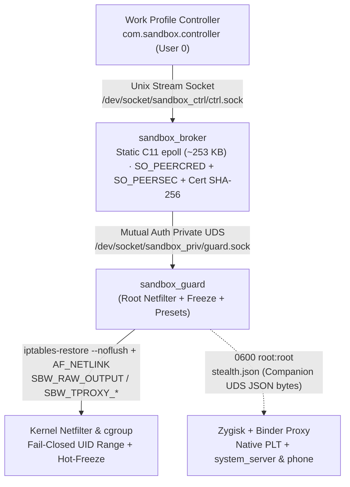

# Architecture Overview

KernBox separates control, enforcement, privilege brokering, and in-process stealth across four minimally privileged components compiled specifically for each `(oem, kernel, root)` target.

## 1. Component Topology



## 2. Fail-Closed Netfilter & Upgrade Fence (`guard/internal/daemon/fence.go`)

Sandbox UID traffic (`UserID * 100000 .. UserID * 100000 + 99999`, excluding clone users like `999`) is isolated fail-closed across deterministic states:

```mermaid
stateDiagram-v2
    [*] --> StateBlockedBoot
    StateBlockedBoot --> StateBlockedLocked: Policy pinned, raw drop armed
    StateBlockedLocked --> StateAckWait: Proxy core starting (exemption.v1.json)
    StateAckWait --> StateOpen: Fresh sandbox_ack.v1.json verified
    StateAckWait --> StateBlockedLocked: AckWaitTimeoutNs expired
    StateOpen --> StateUpgradingFence: ctl upgrade-begin (raw drop re-armed)
    StateUpgradingFence --> StateOpen: New gen sandbox_ack.v1.json &amp; ctl upgrade-end
```

1. **`StateBlockedBoot` / `StateBlockedLocked`**: `SBW_RAW_OUTPUT` arms TCP-reset/drop before an authenticated proxy core acknowledgement arrives.
2. **`StateAckWait`**: Transitional ack wait state (`AckWaitTimeoutNs`) with raw drop protection while writing `exemption.v1.json`.
3. **`StateOpen`**: Proxy acknowledgement (`sandbox_ack.v1.json`) matches generation & boot ID -> disarms `SBW_RAW_OUTPUT` and routes the sandbox UID range into `SBW_TPROXY_OUT` / `SBW_TPROXY_PRE`.
4. **`StateUpgradingFence`**: Bounded upgrade window (`ctl upgrade-begin`) keeps exemption candidate intact while re-arming raw drop until the upgraded core posts a fresh generation ack.
- Default OSS builds run lean TProxy-only (`!transport_vpn`). Legacy VPN switchover support remains cleanly gated behind `-tags transport_vpn`.

## 3. Compile-Time Kernel Tier Adaptation

| Feature | `k510` (Default, Linux 5.10+) | `k419` (`-tags kernel_compat`) |
| :--- | :--- | :--- |
| Confinement file I/O | `openat2` (`RESOLVE_BENEATH \| RESOLVE_NO_SYMLINKS`) | Segment-by-segment `openat(O_NOFOLLOW)` with `fstat` dir/dev verification |
| Process termination | `pidfd_open` + `pidfd_send_signal` | Two-phase `/proc/<pid>/stat` starttime + `/proc/<pid>/status` UID verification + `kill` |
| Memory reclaim | `process_madvise(MADV_PAGEOUT)` via `pidfd` | Safe no-op (`ProcessReclaim = "noop_compat"`) |
| App hot-freeze | cgroup v2 `uid_<uid>/cgroup.freeze` | cgroup v1 `/freezer/uid_<uid>/freezer.state` fallback |

## 4. Two-Layer Stealth & Bootloop Kill-Switch (`stealth/`)

- **Layer A (Native PLT / `bionic` in-process)**: Hooks `__system_property_find`, `__system_property_read_callback`, `__system_property_get` across `/libandroid_runtime.so`, `/libbase.so`, `/libcutils.so`, `/libutils.so`, and `getifaddrs` inside `/libjavacore.so`.
  - Pre-baked fixed slots eliminate heap allocation on hot paths and compile **only the OEM's actual region/carrier properties** (`OEM_HYPEROS`, `OEM_OPLUS`, `OEM_ONEUI`, `OEM_AOSP`, `OEM_GENERIC`).
- **Layer B (`system_server` + `com.android.phone` Java Binder Proxy)**:
  - Loaded via `InMemoryDexClassLoader` (never touches app-writable storage).
  - Wraps 7 `system_server` services (`user`, `device_policy`, `crossprofileapps`, `location`, `wifi`, `connectivity`, `bluetooth_manager`) and 3 `com.android.phone` services (`phone`, `isub`, `iphonesubinfo`).
  - Uses caller stack inspection (`ActivityManagerService.addServiceToMap` / `getCommonServicesLocked`) so internal `system_server` direct Java casts continue receiving raw binders while cross-process app transactions pass through `SandboxBinderWrapper`.
- **Two-Strike Bootloop Kill-Switch**: `post-fs-data.sh` increments `stealth_boot_tries`; `service.sh` resets it to `0` once `sys.boot_completed=1`. If two consecutive boots fail to reach `sys.boot_completed=1`, `post-fs-data.sh` creates `zygisk_disabled` and sets `"enabled": false` in `stealth.json` before Zygote forks.

## 5. Real-Device Isolation Boundary Matrix

KernBox strictly separates **in-scope OS/kernel isolation** from **hardware TEE attestation** and **server-side account/device history**:

| Layer | Responsibility | Owner | Engineering Notes |
| :--- | :--- | :--- | :--- |
| **OS / Kernel / Binder Isolation** | Netfilter `SBW_*` fail-closed isolation, Work Profile `user`/`device_policy`/`crossprofileapps` masking, `connectivity`/`wifi`/`bluetooth_manager`/`phone` sanitization, Native PLT property/interface hooks, boot/debug `resetprop`, hot-freeze/PSI reclaim | **KernBox** (First-party) | Same rules apply uniformly to sandboxed apps and sandboxed GMS (`isolatedProcess` + `system_server`). |
| **Pre-flight & Hygiene Audit** | Anonymized `real_device_readiness` checks (BL state, root hider, TrickyStore/PIF, ADB, accessibility) & 12-item `KernBoxVerify.apk` scorecard | **KernBox** (First-party) | Probe APK is uninstalled (`adb uninstall`) immediately after verification passes. |
| **Hardware KeyMint TEE / Root Mount Unmount** | Hardware `RootOfTrust` leaf/chain attestation (`MEETS_STRONG_INTEGRITY`) and kernel mount-namespace unmount for rootless `/proc/self/mountinfo` | **Root & TEE Companions** (KernelSU umount / Shamiko / TrickyStore / PlayIntegrityFix) | KernBox detects and surfaces readiness status; it does not bundle third-party TEE spoofing blobs. |
| **Server-Side History & Risk Scoring** | Server-retained device trust (`Device Recall`, `Recent Device Activity`), IP reputation, phone/QR anti-abuse counters, and account eligibility | **External Service Backend (Out of Scope)** | KernBox intentionally preserves consistent real hardware identity rather than fabricating mismatched device models or fake IMEIs, and warns against rapid cross-region preset switching. |
