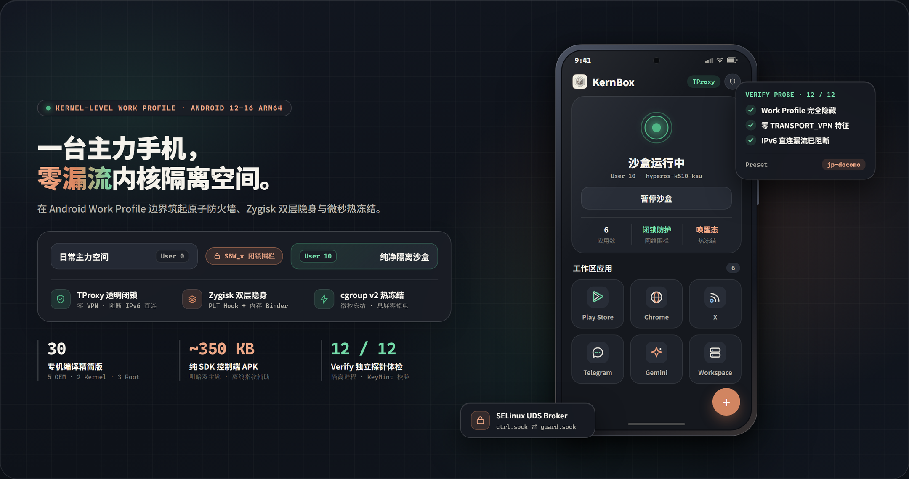
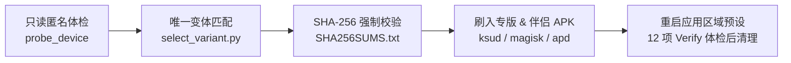

<p align="center">
  
</p>

<h1 align="center">KernBox</h1>

<p align="center">
  <strong>让一台日常 Root 安卓手机，拥有一个「零漏流、隐身干净、不唤醒不掉电」的独立隔离工作空间</strong><br/>
  编译期裁剪 30 个专机精简版 · 极简纯 SDK 控制端 APK · 手机 + 电脑 AI Agent 一键联动部署
</p>

<p align="center">
  <a href="https://github.com/Touka404x/KernBox/actions/workflows/ci.yml"></a>
  <a href="https://github.com/Touka404x/KernBox/releases/latest"></a>
  <a href="LICENSE"></a>
  
  
</p>

<p align="center">
  <strong>简体中文</strong> ·
  <a href="README_EN.md">English</a> ·
  <a href="https://github.com/Touka404x/KernBox/releases/latest">下载发布包</a> ·
  <a href="ARCHITECTURE.md">架构原理</a> ·
  <a href="docs/TPROXY_INTEGRATION.md">TProxy 对接</a> ·
  <a href="docs/FAQ.md">常见问题</a> ·
  <a href="agent-prompts/INSTALL_CN.md">AI 安装剧本</a>
</p>

<p align="center">
  <picture>
    <source media="(prefers-color-scheme: dark)" srcset="assets/kernbox-showcase-zh-dark.png" />
    <source media="(prefers-color-scheme: light)" srcset="assets/kernbox-showcase-zh-light.png" />
    
  </picture>
</p>

---

## KernBox 到底解决什么问题？

很多人为了兼顾**日常主力手机**与**海外服务 / 隐私隔离账号（如独立 Google 生态、AI 服务、跨区应用）**，不得不多带一台备用机，或者直接在主力机上用「普通双开 App + 全局 VPN」。在真实风控和隐私对抗场景下，这两种土办法往往很快翻车。

**KernBox 的目标非常聚焦：让你只带一台已 Root 的安卓手机，在 Android Work Profile（工作资料，如 User 10）里隔出一个行为更接近「独立真实干净设备」的工作空间，同时不拖累主空间续航。**

### 传统方案痛点 vs KernBox 方案

| 核心痛点 | 传统双开 / 普通 VPN 为什么翻车？ | KernBox 如何从内核与系统层解决？ |
| :--- | :--- | :--- |
| **1. 瞬断漏流与 IPv6 泄漏** | 开机未连代理、锁屏杀后台、切换节点或升级代理核的瞬间，工作区 App 直接走真实宽带/IPv6 直连暴露。 | **Fail-Closed 原子防火墙 + 升级围栏**：通过 `iptables-restore --noflush` 维护 `SBW_RAW_OUTPUT` / `SBW_TPROXY_*`，默认主路径 **零 `TRANSPORT_VPN` 特征**，未收到代理核确认前确定性阻断。 |
| **2. 工作空间与区域环境矛盾** | 目标 App（含 `isolatedProcess` 进程）可读取 Work Profile 管理状态、本地回环 VPN 特征，或发现「代理出口在日本但系统语言/时区/运营商仍是本地」。 | **双层 Zygisk PLT + Binder 动态代理**：拦截 Work Profile/Connectivity/Wifi/Bluetooth/Location 等接口与 Native 属性，配套 6 套可热切换的 [`presets/`](presets/) 区域预设，并保持真实硬件属性前后一致。 |
| **3. 全家桶后台唤醒狂掉电** | 工作空间里常驻的 GMS 与海外应用在息屏后频繁唤醒，导致主力机发热掉电。 | **微秒级 cgroup v2 热冻结 & 内存回收**：暂停时原生写入 `cgroup.freeze`（`k419` 回退 cgroup v1）并按需触发 `process_madvise(MADV_PAGEOUT)`，用完即冻、打开即恢复。 |
| **4. 通用模块臃肿、容易卡开机** | 单个模块硬塞所有 OEM 适配和老内核兼容代码，包体庞大、SELinux 规则过宽、刷错即变砖。 | **30 个编译期特化精简版 + AI Agent 选包**：按 `5 OEM × 2 内核 × 3 Root` 编译裁剪（单包 ~4.1 MB），自动 **两连开机失败关闭隐身熔断**，配套浅/深色自适应 [`KernBox.apk`](controller/)（支持离线指纹复制、长按强停/卸载、App 内实时自检）。 |

> [!NOTE]
> **能力边界声明（不吹牛、讲真话）**  
> KernBox 专注解决 **OS / 内核网络隔离、Work Profile 隐身语义与低功耗热冻结**，并会通过 [`KernBoxVerify.apk`](verify/) 生成 12 项体检评分卡。  
> - **硬件 KeyMint TEE 与根挂载隐藏**（如已解锁 BL 下的强完整性校验、无痕 `/proc/self/mountinfo`）：属于 Root 与 TEE 伴侣模块的职责，KernBox 仅做就绪探测与配合，建议与 KernelSU umount / TrickyStore / PlayIntegrityFix 搭配使用。  
> - **服务端长期账号历史与 IP 信誉**：KernBox 故意**不伪造**互相矛盾的 IMEI/机型信息；稳定性依靠「一沙盒固定匹配一个区域预设、避免高频切区、优先热冻结而非反复重装」。

---

## 30 秒上手：手机 + 电脑 AI Agent 联动安装（推荐）

不用背命令，也不用自己判断内核档位和 cgroup 版本。确保手机已 Root（`KernelSU` / `Magisk` / `APatch`）并开启 **USB 调试（ADB）** 连上电脑后，在仓库目录打开任意终端 AI Agent（Antigravity、Claude Code、Codex、Cursor、Gemini CLI 等），发送下面这段话：

```text
请阅读 agent-prompts/INSTALL_CN.md，严格按其中顺序为我当前连接的安卓手机执行安装：先运行只读匿名探测脚本与 tools/select_variant.py 匹配唯一最优的 KernBox 变体包，核对 SHA256SUMS.txt 校验和，刷入模块、重启前与安装探针前都先停下来让我确认。全程禁止回显我的硬件序列号、IMEI、MAC 或 IP。
```



---

## 30 专机变体覆盖矩阵

每次发布同步产出 `5 大系统阵营 × 2 档内核能力 × 3 类 Root 管理器 = 30 个 ARM64 模块包`（`KernBox-<oem>-<kernel>-<root>-arm64.zip`）与两个共享统一自适应图标的纯 SDK APK（[`KernBox.apk`](controller/) 与 [`KernBoxVerify.apk`](verify/)）：

| 维度 | 覆盖范围 | 编译期特化裁剪 |
| :--- | :--- | :--- |
| **手机系统（5 大阵营）** | `hyperos`（小米/Redmi/POCO）、`aosp`（Pixel/LineageOS/类原生）、`oplus`（一加/OPPO/realme）、`oneui`（三星）、`generic`（其他品牌兜底） | Go `-tags oem_<oem>` 与 C++ `-DOEM_<OEM>` 精准裁剪隐藏应用、克隆用户排除与属性槽位；小米等设备刷入类原生 ROM 会自动命中 `aosp`。 |
| **内核档位（2 档）** | `k510`（Linux 5.10+ 且支持 cgroup v2 freeze）、`k419`（Linux 4.14–5.9 或无 cgroup v2） | `k510` 启用 `openat2`、`pidfd`、`process_madvise` 与 cgroup v2 热冻结；`k419`（`-tags kernel_compat`）切换安全路径防符号链接与 cgroup v1 兼容路径。 |
| **Root 管理器** | `ksu`、`ksu_legacy`（KSU `< 0.9` / `k419`）、`magisk`、`apatch` | 注入对应管理器专用 `sepolicy.rule`、工具链查找与官方 CLI 刷入对接。 |

---

## 完整文档导航

无论你是**初次上手的用户**、**想对接本地 TProxy 代理核的折腾党**，还是**准备贡献代码的开发者**，都可以按需直达：

| 文档 | 解决什么疑问？ |
| :--- | :--- |
| [**架构设计与信任边界**](ARCHITECTURE.md) | 状态机、UDS Broker 权限分离、两层隐身原理、内核两档能力与隔离边界矩阵（含 Mermaid 图） |
| [**TProxy 外部代理核对接指南**](docs/TPROXY_INTEGRATION.md) | 外部代理核（Mihomo / Sing-box）如何配置 `policy.json`、`sandbox_ack.v1.json` 握手与无漏流升级围栏 |
| [**常见问题排查 (FAQ)**](docs/FAQ.md) | Work Profile 准备、签名绑定、`neutral` 与切区注意事项、12 项体检 `warn` 处理与开机熔断恢复 |
| [**30 变体矩阵清单**](VARIANT_MATRIX.md) | 全部 30 个发布包名与 Go / C++ 编译期标志对照表 |
| [**AI 安装 / 诊断 / 回滚剧本**](agent-prompts/INSTALL_CN.md) | [中文安装](agent-prompts/INSTALL_CN.md) · [English Install](agent-prompts/INSTALL_EN.md) · [脱敏诊断](agent-prompts/DIAGNOSE.md) · [无感升级与回滚](agent-prompts/UPGRADE_AND_ROLLBACK.md) |
| [**安全声明 / 贡献指南 / 更新日志**](SECURITY.md) | [安全政策](SECURITY.md) · [贡献规范与本地校验](CONTRIBUTING.md) · [版本变更记录](CHANGELOG.md) |

---

## 仓库目录速览 & 从源码一键构建

| 目录 | 职责说明 |
| :--- | :--- |
| [`guard/`](guard/) | Root 守护进程 `sandbox_guard`、SELinux 隔离代理 `sandbox_broker`、防火墙状态机与 `-race` 单测 |
| [`stealth/`](stealth/) | C++17 Zygisk PLT Hook + 内存加载 DEX Binder 动态代理与宿主机校验测试 |
| [`controller/`](controller/) | 纯 SDK 极简控制端源码与构建器（[`KernBox.apk`](controller/)，`com.sandbox.controller`） |
| [`verify/`](verify/) | 独立非特权 12 项真机隔离验证探针源码与构建器（[`KernBoxVerify.apk`](verify/)，`com.sandbox.verify`） |
| [`packaging/`](packaging/) | 4 类 Root 管理器 `sepolicy.rule`、启动脚本模板与严格 UNIX LF 打包器 |
| [`presets/`](presets/) | 6 套区域/运营商运行期热切换预设 JSON（`neutral` / `jp-docomo` / `us-tmobile` / `uk-ee` / `sg-singtel` / `de-telekom`） |
| [`tools/`](tools/) | 设备只读探测脚本、确定性选包器、全 30 变体+双 APK 构建矩阵与隐私泄漏门禁 |

配置好 `go`（匹配 [`guard/go.mod`](guard/go.mod)）、`JAVA_HOME`（JDK 21）、`ANDROID_SDK_ROOT`（`android-35` + `build-tools;35.0.0`）、`ANDROID_NDK_HOME` 与 Python 3.10+ 后执行：

```bash
python ./tools/build_matrix.py --version 1.2.0
```

全部产出写入 `./dist/`（已 gitignore）：30 个 `KernBox-*-arm64.zip`、`KernBox.apk`、`KernBoxVerify.apk`、`SHA256SUMS.txt` 与 `variants-manifest.json`。所有源码均强制通过 [`tools/verify_privacy_leak.py`](tools/verify_privacy_leak.py) 门禁校验，不含任何遥测、硬件序列号、私有 IP 或预置密钥，基于 [Apache License 2.0](LICENSE) 开源。
