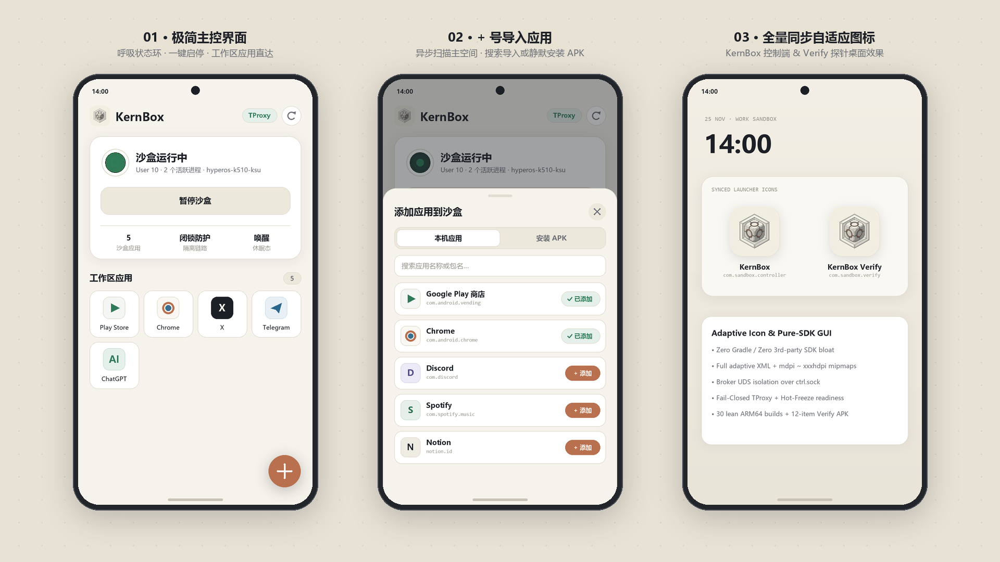
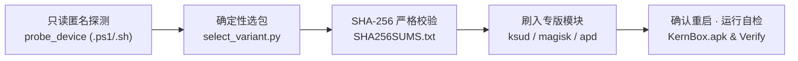

<p align="center">
  
</p>

<h1 align="center">KernBox</h1>

<p align="center">
  <strong>面向 Root 安卓设备的内核级零漏流隔离沙盒</strong><br/>
  编译期裁剪 30 个专机精简版 · 极简纯 SDK 伴侣控制端 · 手机 + 电脑 AI Agent 一键联动部署
</p>

<p align="center">
  <a href="https://github.com/Touka404x/KernBox/actions/workflows/ci.yml"></a>
  <a href="https://github.com/Touka404x/KernBox/releases/latest"></a>
  <a href="LICENSE"></a>
  
  
</p>

<p align="center">
  <strong>简体中文</strong> ·
  <a href="README_EN.md">English</a> ·
  <a href="https://github.com/Touka404x/KernBox/releases/latest">下载发布包</a> ·
  <a href="VARIANT_MATRIX.md">30 变体矩阵</a> ·
  <a href="ARCHITECTURE.md">架构设计</a> ·
  <a href="agent-prompts/INSTALL_CN.md">AI 安装剧本</a> ·
  <a href="SECURITY.md">安全声明</a>
</p>

---

<p align="center">
  
</p>

---

## 为什么做 KernBox？

传统的安卓工作空间与多开隔离模块，往往把所有厂商适配、老内核回退和多个 Root 框架的分支全部塞进一个大包里——体积臃肿、冗余分支多、SELinux 规则过宽，不仅费电，也容易留下可识别特征。

**KernBox 反其道而行之：**
- **绝不做臃肿全家桶**：在编译期按「手机系统 × 内核档位 × Root 管理器」精准拆分为 **30 个专机专用精简包**（单包约 `4.1 MB`），仅编译和运行目标机型真实需要的内核与厂商路径。
- **零依赖极简控制端 `KernBox.apk`**：直接基于纯 Android SDK 原生绘制，配备呼吸状态环、一键沙盒启停、工作区应用直达与 `+` 号热导入抽屉，完全经由非特权 `sandbox_broker` 通信。
- **手机 + 电脑 AI Agent 联动安装**：不需要手查内核版本与 cgroup 类型。手机开启 USB 调试连上电脑，把安装剧本发给任意终端 AI Agent，自动完成脱敏体检、1-of-30 精确选包、SHA-256 强校验与刷入验收。

---

## 30 秒上手：手机 + 电脑 AI Agent 联动安装（推荐）

### 准备工作
1. 一台已 Root 的 **ARM64（`arm64-v8a`）Android 12+（API 31+）** 手机（`KernelSU`、`Magisk` 或 `APatch`），已开启 **USB 调试（ADB）** 并授权连接电脑。
2. 电脑上任意终端 AI Coding Agent（Antigravity、Claude Code、Codex、Cursor、Gemini CLI 等）。

### 复制发送给你的电脑 Agent
在本仓库根目录打开对话并发送：

```text
请阅读 agent-prompts/INSTALL_CN.md，严格按其中顺序为我当前连接的安卓手机执行安装：先运行只读匿名探测脚本与 tools/select_variant.py 匹配唯一最优的 KernBox 变体包，核对 SHA256SUMS.txt 校验和，刷入模块、重启前与安装探针前都先停下来让我确认。全程禁止回显我的硬件序列号、IMEI、MAC 或 IP。
```



---

## 适配矩阵（30 专版 + 双伴侣 APK）

每次发布同步产出 `5 大系统阵营 × 2 档内核能力 × 3 类 Root 管理器 = 30 个 ARM64 模块包`（`KernBox-<oem>-<kernel>-<root>-arm64.zip`）与两个采用统一自适应图标的独立 APK（[`KernBox.apk`](controller/) 与 [`KernBoxVerify.apk`](verify/)）：

| 维度 | 覆盖范围 | 编译期特化裁剪 |
| :--- | :--- | :--- |
| **手机系统（5 大阵营）** | `hyperos`（小米/Redmi/POCO）、`aosp`（Pixel/LineageOS/类原生）、`oplus`（一加/OPPO/realme）、`oneui`（三星）、`generic`（其他品牌兜底） | Go `-tags oem_<oem>` 与 C++ `-DOEM_<OEM>` 精准裁剪隐藏应用规则、克隆用户排除、冻结适配与属性槽位；小米硬件刷类原生 ROM 自动归入 `aosp`。 |
| **内核档位（2 档）** | `k510`（Linux 5.10+ 且支持 cgroup v2 freeze）、`k419`（Linux 4.14–5.9 或无 cgroup v2） | `k510` 启用 `openat2`、`pidfd`、`process_madvise(MADV_PAGEOUT)` 与 cgroup v2 热冻结；`k419`（`-tags kernel_compat`）切换安全路径防符号链接与 cgroup v1 兼容路径。 |
| **Root 管理器（全覆盖）** | `ksu`、`ksu_legacy`（KSU `< 0.9` / `k419`）、`magisk`、`apatch` | 内置各管理器专用 `sepolicy.rule`、工具链路径检索与官方 CLI 安装对接。 |

> 完整 30 个产物的包名与编译标志见 [`VARIANT_MATRIX.md`](VARIANT_MATRIX.md)。

---

## 核心技术能力

- **零漏流原子防火墙与升级围栏（Fail-Closed）**：基于 `iptables-restore --noflush` 原子管理 `SBW_RAW_OUTPUT`、`SBW_OUTPUT`、`SBW_EGRESS`、`SBW_TPROXY_*` 链路，启动窗口、锁屏状态与代理核升级期间自动闭锁，默认主路径零 `TRANSPORT_VPN` 特征。
- **微秒级热冻结与主动内存回收**：`k510` 原生操控 `cgroup.freeze` 配合压力触发 `process_madvise(MADV_PAGEOUT)`，工作区后台接近零功耗；`k419` 自动切换 cgroup v1 / 休眠兼容路径。
- **SELinux `sandbox_broker` 权限分离**：双层 UDS（`ctrl.sock` 与 `guard.sock`）严格隔离非特权控制端与 Root 守护进程，校验证书 SHA-256、内核 `SO_PEERCRED` 与共享令牌。
- **双层 Zygisk + Binder 隐身与防卡开机熔断**：Native PLT 零内存分配覆写属性/网口，配合内存加载 DEX 动态代理（`system_server` + `com.android.phone`）；内置 [`presets/`](presets/) 6 套区域预设（默认中性 `neutral`，支持 `ctl preset-apply` 热切换）及 **连续两次开机未完成自动解除隐身钩子** 保护。
- **极简控制端 & 独立验收探针**：[`KernBox.apk`](controller/)（`com.sandbox.controller`）支持一键启停沙盒、工作区应用启动与 `+` 号导入/安装 APK；[`KernBoxVerify.apk`](verify/)（`com.sandbox.verify`）在隔离用户内输出 12 项真机体检评分卡。

---

## 仓库目录与 AI 运维剧本

| 目录 / 文档 | 用途 |
| :--- | :--- |
| [`guard/`](guard/) | Go 守护进程 `sandbox_guard`、`sandbox_broker`、OEM/内核特化实现与 `-race` 单元测试 |
| [`stealth/`](stealth/) | C++17 Zygisk PLT 模块 + Java Binder 动态代理与宿主机校验测试 |
| [`controller/`](controller/) | 极简安静奢华风伴侣控制端源码与纯 SDK 构建器（`KernBox.apk`） |
| [`verify/`](verify/) | 独立非特权 12 项隔离验证探针（`KernBoxVerify.apk`） |
| [`packaging/`](packaging/) | 4 类 Root 管理器 `sepolicy.rule`、启动脚本模板与严格 UNIX LF 打包器 |
| [`presets/`](presets/) | 6 套区域/运营商运行期热切换预设 JSON |
| [`tools/`](tools/) | 匿名探测脚本、确定性选包器、全量矩阵构建器与隐私泄漏门禁 |
| [`agent-prompts/`](agent-prompts/) | AI 安装剧本（[中文](agent-prompts/INSTALL_CN.md) / [EN](agent-prompts/INSTALL_EN.md)）、[脱敏诊断](agent-prompts/DIAGNOSE.md)、[无感升级与回滚](agent-prompts/UPGRADE_AND_ROLLBACK.md) |
| [`ARCHITECTURE.md`](ARCHITECTURE.md) | 状态机、UDS 契约、权限边界与隔离矩阵详述 |

---

## 从源码一键构建全部 30 专版 + 双 APK

准备好 `go`（匹配 [`guard/go.mod`](guard/go.mod)）、`JAVA_HOME`（JDK 21）、`ANDROID_SDK_ROOT`（`android-35` & `build-tools;35.0.0`）、`ANDROID_NDK_HOME` 与 Python 3.10+ 后执行：

```bash
# 跨平台 Python 构建入口
python ./tools/build_matrix.py --version 1.0.0
```

```powershell
# Windows PowerShell 封装
.\tools\build_matrix.ps1 -Version 1.0.0
```

所有构建产物输出至 `./dist/`（已 gitignore）：30 个 `KernBox-<oem>-<kernel>-<root>-arm64.zip`、`KernBox.apk`、`KernBoxVerify.apk`、`SHA256SUMS.txt` 与 `variants-manifest.json`。源码亦保留可选编译标志 `-tags transport_vpn` 供特殊 VPN 兼容构建。

---

## 隐私、安全与开源协议

- **隐私零采集 / 零泄漏门禁**：本地设备探测脚本在落盘前自动剥离序列号、IMEI、MAC 与私有 IP，仓库每次变更均由 [`tools/verify_privacy_leak.py`](tools/verify_privacy_leak.py) 强制门禁检查。
- **安全与贡献**：漏洞披露与信任边界见 [`SECURITY.md`](SECURITY.md)，提交流程与 pre-PR 检查见 [`CONTRIBUTING.md`](CONTRIBUTING.md)。
- **使用声明**：本项目仅用于个人隐私隔离、Android Work Profile 机制研究与防御性安全测试，请遵守所在地区法律法规与平台条款。
- **开源协议**：[Apache License 2.0](LICENSE)
