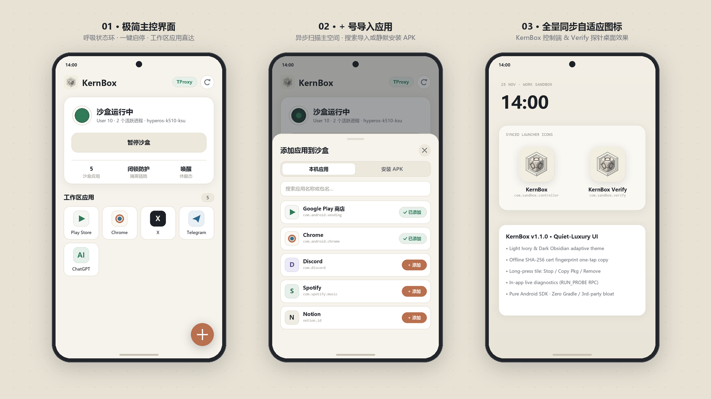
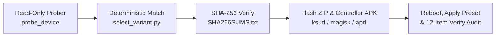

<p align="center">
  
</p>

<h1 align="center">KernBox</h1>

<p align="center">
  <strong>Give a single rooted Android phone a leak-proof, stealth-clean, low-drain isolated workspace</strong><br/>
  30 compile-time-specialized ARM64 builds · Minimalist pure-SDK controller APK · AI-Agent co-installation
</p>

<p align="center">
  <a href="https://github.com/Touka404x/KernBox/actions/workflows/ci.yml"></a>
  <a href="https://github.com/Touka404x/KernBox/releases/latest"></a>
  <a href="LICENSE"></a>
  
  
</p>

<p align="center">
  <a href="README.md">简体中文</a> ·
  <strong>English</strong> ·
  <a href="https://github.com/Touka404x/KernBox/releases/latest">Download Latest</a> ·
  <a href="ARCHITECTURE.md">Architecture</a> ·
  <a href="docs/TPROXY_INTEGRATION.md">TProxy Guide</a> ·
  <a href="docs/FAQ.md">FAQ</a> ·
  <a href="agent-prompts/INSTALL_EN.md">AI Install Playbook</a>
</p>

---

<p align="center">
  
</p>

---

## What Problem Does KernBox Solve?

Keeping privacy-sensitive or region-locked ecosystems (isolated Google services, international accounts, AI clients) separate from your daily driver usually forces two compromised choices: carrying a second spare phone, or running app-cloners alongside a global VPN where leaks, `TRANSPORT_VPN` flags, timezone/carrier mismatches, and constant background wakeups quickly defeat the setup.

**KernBox solves this on a single rooted Android device**: it carves out an Android Work Profile (e.g., User 10) enforced at the kernel/Netfilter/Binder boundary so sandboxed apps see a clean, coherent environment without draining your primary phone battery.

### Traditional Workarounds vs. KernBox

| Pain Point | Why Common Setups Fail | How KernBox Solves It |
| :--- | :--- | :--- |
| **1. Transient & IPv6 Leaks** | Apps leak direct IPv4/IPv6 traffic during boot, screen-off kills, proxy switches, or proxy-core upgrades. | **Fail-Closed Netfilter & Upgrade Fence**: Atomic `iptables-restore --noflush` rules across `SBW_RAW_OUTPUT` / `SBW_TPROXY_*`, zero `TRANSPORT_VPN` footprint on the default TProxy path. |
| **2. Work Profile & Locale Mismatches** | Sandboxed apps (and `isolatedProcess`) inspect Work Profile APIs, `VpnTransport`, or notice locale/timezone/carrier contradictions. | **Two-Layer Zygisk PLT + Binder Proxy**: In-memory DEX proxy + zero-alloc native hooks + 6 hot-switchable [`presets/`](presets/) keeping true hardware identity consistent. |
| **3. Heavy Idle Battery Drain** | Isolated GMS and background services keep waking the CPU even when unused. | **Microsecond Hot-Freeze & Reclaim**: Native cgroup v2 `cgroup.freeze` (`k510`) + `process_madvise(MADV_PAGEOUT)`, falling back cleanly to cgroup v1 on `k419`. |
| **4. Bloated Modules & Bootloops** | Universal zip bundles carry dead OEM workarounds, wide SELinux rules, and brittle installs. | **30 Lean Variants + AI Co-Install**: Compile-time specialization (`5 OEMs × 2 Kernel Tiers × 3 Root Managers`, ~4.1 MB), automatic 2-strike bootloop kill-switch, and Light/Dark adaptive [`KernBox.apk`](controller/) (offline cert copy, long-press Stop/Remove, in-app `RUN_PROBE` diagnostics). |

> [!NOTE]
> **Honest Threat-Model Boundary**  
> KernBox strictly owns **OS/kernel network isolation, Work Profile masking, consistent region semantics, and low-drain hot-freeze**, verified by the 12-item [`KernBoxVerify.apk`](verify/) scorecard.  
> - **Hardware KeyMint TEE & Root Mount Hiding**: Pair with KernelSU umount / TrickyStore / PlayIntegrityFix when running an unlocked bootloader; KernBox surfaces readiness transparently without bundling third-party TEE blobs.  
> - **Server-Side History & IP Reputation**: KernBox intentionally avoids fabricating contradictory hardware IMEIs/models; long-term stability relies on pinning one matching region preset per sandbox and preferring hot-freeze over repeated reinstalls.

---

## 30-Second Quick Start with an AI Agent (Recommended)

Plug your rooted **ARM64 Android 12+ (`KernelSU` / `Magisk` / `APatch`)** phone into your PC with **USB Debugging (ADB)** enabled and send this prompt to your terminal AI coding agent:

```text
Read agent-prompts/INSTALL_EN.md and follow its workflow strictly in order for my connected Android phone: run the read-only anonymized device prober, match the exact KernBox variant via tools/select_variant.py, verify the artifact SHA-256 against SHA256SUMS.txt, and pause for my confirmation before flashing, rebooting, or running post-boot checks. Never print my hardware serial, IMEI, MAC, or IP.
```



---

## 30-Variant Device Matrix

Every release ships `5 OEMs × 2 Kernel Tiers × 3 Root Managers per tier = 30 ARM64 ZIPs` (`KernBox-<oem>-<kernel>-<root>-arm64.zip`) plus two APKs sharing the official adaptive icon ([`KernBox.apk`](controller/) and [`KernBoxVerify.apk`](verify/)):

| Axis | Coverage | Specialization Notes |
| :--- | :--- | :--- |
| **OEM Profiles (5)** | `hyperos`, `aosp`, `oplus`, `oneui`, `generic` | Go `-tags oem_<oem>` & C++ `-DOEM_<OEM>` strip unrelated OEM bloat rules, clone exclusions, and property slots at compile time. Custom AOSP ROMs select `aosp`. |
| **Kernel Tiers (2)** | `k510`, `k419` | `k510` (Linux 5.10+ w/ cgroup v2 freeze): `openat2`, `pidfd`, `process_madvise`, `cgroup.freeze`. `k419` (`-tags kernel_compat`): `openat(O_NOFOLLOW)`, verified `/proc` kill, cgroup v1 fallback. |
| **Root Managers** | `ksu`, `ksu_legacy`, `magisk`, `apatch` | Tailored `sepolicy.rule`, tool lookup, and CLI install integration. |

---

## Complete Documentation Map

| Document | Topic |
| :--- | :--- |
| [**Architecture & Trust Boundaries**](ARCHITECTURE.md) | Component topology, UDS broker separation, state machine, two-layer stealth, and boundary matrix |
| [**TProxy Integration Guide**](docs/TPROXY_INTEGRATION.md) | Wiring local Mihomo / Sing-box cores via `policy.json`, `sandbox_ack.v1.json`, and zero-leak upgrade fence |
| [**Troubleshooting & FAQ**](docs/FAQ.md) | Work Profile setup, signing cert binding, `neutral` vs regional presets, 12-item scorecard warnings, bootloop recovery |
| [**30-Variant Matrix**](VARIANT_MATRIX.md) | Full list of all 30 release ZIPs and compile flags |
| [**AI Operations Playbooks**](agent-prompts/INSTALL_EN.md) | [English Install](agent-prompts/INSTALL_EN.md) · [中文安装](agent-prompts/INSTALL_CN.md) · [Diagnose](agent-prompts/DIAGNOSE.md) · [Upgrade & Rollback](agent-prompts/UPGRADE_AND_ROLLBACK.md) |
| [**Security / Contributing / Changelog**](SECURITY.md) | [Security Policy](SECURITY.md) · [Contributing & Local Checks](CONTRIBUTING.md) · [Changelog](CHANGELOG.md) |

---

## Build from Source & Privacy Guarantee

With `go` (matching [`guard/go.mod`](guard/go.mod)), `JAVA_HOME` (JDK 21), `ANDROID_SDK_ROOT` (`platforms;android-35`, `build-tools;35.0.0`), `ANDROID_NDK_HOME`, and Python 3.10+:

```bash
python ./tools/build_matrix.py --version 1.1.0
```

Outputs are written to `./dist/` (gitignored). All repository commits pass [`tools/verify_privacy_leak.py`](tools/verify_privacy_leak.py) with zero telemetry, hardware serials, private IPs, or prebuilt keystores, released under [Apache License 2.0](LICENSE).
