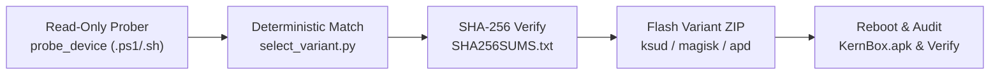

<p align="center">
  
</p>

<h1 align="center">KernBox</h1>

<p align="center">
  <strong>Kernel-level isolated Android Work Profile sandbox</strong><br/>
  30 lean compile-time-specialized ARM64 builds · Minimalist pure-SDK controller APK · AI-Agent co-installation
</p>

<p align="center">
  <a href="https://github.com/Touka404x/KernBox/actions/workflows/ci.yml"></a>
  <a href="https://github.com/Touka404x/KernBox/releases/latest"></a>
  <a href="LICENSE"></a>
  
  
</p>

<p align="center">
  <a href="README.md">简体中文</a> ·
  <strong>English</strong> ·
  <a href="https://github.com/Touka404x/KernBox/releases/latest">Releases</a> ·
  <a href="VARIANT_MATRIX.md">30-Variant Matrix</a> ·
  <a href="ARCHITECTURE.md">Architecture</a> ·
  <a href="agent-prompts/INSTALL_EN.md">AI Install Playbook</a> ·
  <a href="SECURITY.md">Security</a>
</p>

---

<p align="center">
  
</p>

---

## Why KernBox?

Most Android sandbox and multi-profile modules ship one bloated universal binary stuffed with unused OEM workarounds, legacy kernel fallbacks, and overly broad SELinux permissions — hurting battery life, responsiveness, and stealth cleanliness.

**KernBox takes the opposite approach:**
- **30 lean compile-time-specialized builds**: Every release ships 30 targeted ARM64 modules (`5 OEMs × 2 Kernel Tiers × 3 Root Managers`, ~4.1 MB each). Only the exact kernel, OEM, SELinux, and root paths used by your device are compiled and run.
- **Zero-bloat companion controller `KernBox.apk`**: Written purely against the standard Android SDK with a breathing status dial, one-tap sandbox Start/Pause, workspace launcher grid, and an animated `+` drawer talking strictly through the unprivileged `sandbox_broker` socket.
- **AI-Agent Phone + PC co-installation**: Plug your rooted device in via USB Debugging and let your terminal AI agent run anonymized read-only probing, deterministic variant selection, SHA-256 verification, flashing, and post-boot audits step by step.

---

## 30-Second Quick Start with an AI Agent (Recommended)

### Prerequisites
1. A rooted **ARM64 (`arm64-v8a`) Android 12+ (API 31+)** phone (`KernelSU`, `Magisk`, or `APatch`) with **USB Debugging (ADB)** authorized.
2. Any terminal-capable AI coding agent (Antigravity, Claude Code, Codex, Cursor, Gemini CLI, etc.).

### Send This Prompt to Your PC Agent
Open this repository on your PC and send:

```text
Read agent-prompts/INSTALL_EN.md and follow its workflow strictly in order for my connected Android phone: run the read-only anonymized device prober, match the exact KernBox variant via tools/select_variant.py, verify the artifact SHA-256 against SHA256SUMS.txt, and pause for my confirmation before flashing, rebooting, or running post-boot checks. Never print my hardware serial, IMEI, MAC, or IP.
```



---

## 30-Variant Device Coverage

KernBox ships `5 OEMs × 2 Kernel Tiers × 3 Root Managers per tier = 30 ARM64 ZIPs` (`KernBox-<oem>-<kernel>-<root>-arm64.zip`) plus two APKs sharing the official adaptive icon ([`KernBox.apk`](controller/) and [`KernBoxVerify.apk`](verify/)):

| Axis | Coverage | Specialization Notes |
| :--- | :--- | :--- |
| **OEM Profiles (5)** | `hyperos`, `aosp`, `oplus`, `oneui`, `generic` | Go `-tags oem_<oem>` & C++ `-DOEM_<OEM>` trim OEM bloat rules, clone exclusions, freezer paths, and property slots at compile time. Custom AOSP ROMs on OEM hardware automatically select `aosp`. |
| **Kernel Tiers (2)** | `k510`, `k419` | `k510` (Linux 5.10+ with cgroup v2 freeze): `openat2`, `pidfd`, `process_madvise(MADV_PAGEOUT)`, `cgroup.freeze`. `k419` (`-tags kernel_compat`): `openat(O_NOFOLLOW)` traversal, verified `/proc` kill, cgroup v1 fallback. |
| **Root Managers** | `ksu`, `ksu_legacy`, `magisk`, `apatch` | Manager-specific `sepolicy.rule`, busybox/resetprop resolution, and CLI installation integration. |

> See every artifact filename and compile flag in [`VARIANT_MATRIX.md`](VARIANT_MATRIX.md).

---

## Core Capabilities

- **Fail-Closed Netfilter Isolation & Upgrade Fence**: Atomic `iptables-restore --noflush` across `SBW_RAW_OUTPUT`, `SBW_OUTPUT`, `SBW_EGRESS`, and `SBW_TPROXY_*`. Deterministic leak prevention during boot, locked state, and proxy core upgrades with zero `TRANSPORT_VPN` footprint by default.
- **Microsecond Hot-Freeze & Memory Reclaim**: Freezes sandbox Work Profile UIDs via cgroup v2 (`k510`) and reclaims memory under pressure via `process_madvise(MADV_PAGEOUT)`, falling back cleanly to cgroup v1 on `k419`.
- **Privilege-Separated Broker & Root IPC**: Splits unprivileged controller UDS (`/dev/socket/sandbox_ctrl/ctrl.sock`) from root daemon UDS (`/dev/socket/sandbox_priv/guard.sock`) via SELinux `sandbox_broker`, enforcing APK cert SHA-256, `SO_PEERCRED`, and shared token auth.
- **Two-Layer Zygisk + Binder Stealth with Two-Strike Kill-Switch**: Zero-allocation Native PLT hooks paired with an `InMemoryDexClassLoader` dynamic `IServiceManager` proxy in `system_server` & `com.android.phone`, 6 switchable region presets under [`presets/`](presets/), and automatic disablement after 2 failed boots.
- **Minimal Companion Controller & 12-Item Probe APKs**: [`KernBox.apk`](controller/) (`com.sandbox.controller`) for one-tap control and `+` app importing; [`KernBoxVerify.apk`](verify/) (`com.sandbox.verify`) for post-boot isolation & real-device scorecard auditing.

---

## Repository Layout & AI Playbooks

| Path | Purpose |
| :--- | :--- |
| [`guard/`](guard/) | Go daemons `sandbox_guard` & `sandbox_broker`, OEM/kernel specialization & `-race` tests |
| [`stealth/`](stealth/) | C++17 Zygisk PLT hooks + Java Binder dynamic proxy & host tests |
| [`controller/`](controller/) | Pure-SDK minimalist controller APK (`KernBox.apk`) |
| [`verify/`](verify/) | Unprivileged 12-item isolation probe APK (`KernBoxVerify.apk`) |
| [`packaging/`](packaging/) | Root-manager `sepolicy.rule` templates, boot scripts & strict LF packager |
| [`presets/`](presets/) | 6 hot-switchable region/carrier JSON presets (`ctl preset-apply`) |
| [`tools/`](tools/) | Device prober, deterministic selector, 30-variant matrix builder & privacy gate |
| [`agent-prompts/`](agent-prompts/) | Co-install playbooks ([EN](agent-prompts/INSTALL_EN.md) / [CN](agent-prompts/INSTALL_CN.md)), [Diagnose](agent-prompts/DIAGNOSE.md), [Upgrade/Rollback](agent-prompts/UPGRADE_AND_ROLLBACK.md) |
| [`ARCHITECTURE.md`](ARCHITECTURE.md) | State machine, UDS contracts, privilege boundaries & isolation matrix |

---

## Build All 30 Variants + Companion APKs from Source

With `go` (matching [`guard/go.mod`](guard/go.mod)), `JAVA_HOME` (JDK 21), `ANDROID_SDK_ROOT` (`platforms;android-35`, `build-tools;35.0.0`), `ANDROID_NDK_HOME`, and Python 3.10+:

```bash
python ./tools/build_matrix.py --version 1.0.0
```

```powershell
.\tools\build_matrix.ps1 -Version 1.0.0
```

Outputs are written to `./dist/` (gitignored): all 30 `KernBox-<oem>-<kernel>-<root>-arm64.zip` modules, `KernBox.apk`, `KernBoxVerify.apk`, `SHA256SUMS.txt`, and `variants-manifest.json`. Optional source flag `-tags transport_vpn` enables legacy VPN fallback builds.

---

## Privacy, Security & License

- **Zero Telemetry / Privacy Gate**: Probers strip hardware serials, IMEIs, MACs, and IPs locally; all commits pass [`tools/verify_privacy_leak.py`](tools/verify_privacy_leak.py).
- **Security & Contributions**: See [`SECURITY.md`](SECURITY.md) and [`CONTRIBUTING.md`](CONTRIBUTING.md).
- **Intended Use**: Provided strictly for personal privacy isolation, managed work-profile research, and defensive Android security testing. Users are responsible for complying with local laws and platform terms.
- **License**: [Apache License 2.0](LICENSE)
