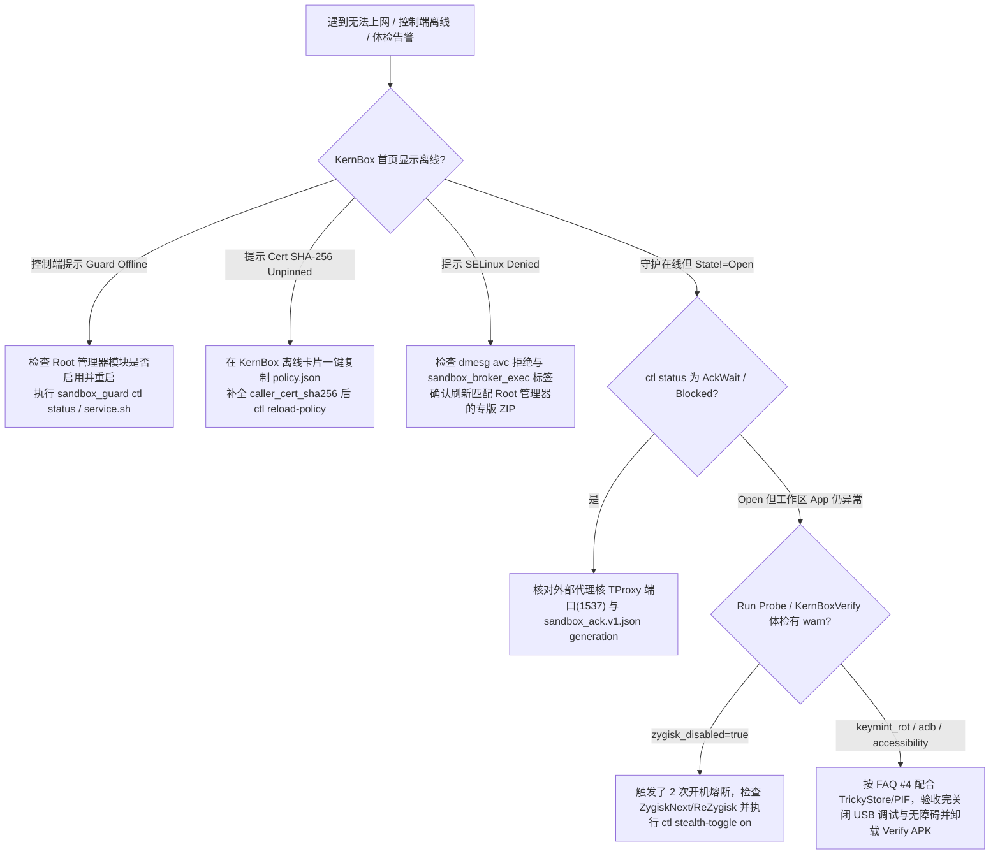

# KernBox 常见问题排查 (FAQ)

---

### 1. KernBox 和普通双开 App / 传统全局 VPN 有什么本质区别？

- **普通双开 / 虚拟容器**：运行在应用层 Hook 或同用户目录隔离下，无法阻止恶意/高权限检测，也无法防止启动、休眠或切节点时的系统直连漏流。
- **传统 Android `VpnService`**：会在系统网络能力中暴露 `TRANSPORT_VPN` 标志，许多强风控应用会直接识别并降权或拒服。
- **KernBox**：直接在 Linux 内核 **Netfilter (`iptables-restore --noflush`)** 与 **Android 原生 Work Profile（如 User 10）** 边界实施 Fail-Closed 流量隔离，默认采用无 `TRANSPORT_VPN` 特征的 **TProxy 透明代理**；配合 **Zygisk Native PLT + Binder 动态代理**、**cgroup 热冻结** 与 **6 套可切换区域预设**，让隔离空间兼顾洁净度与低功耗。

---

### 2. 如何创建工作资料（Work Profile）并绑定 `KernBox.apk` 控制端？

1. 若设备尚无工作资料用户（常见 UID 起始 `user_id = 10`），可通过设备支持的 Work Profile 管理工具（如 Shelter、Insular 或设备策略控制器）预先创建好 Work Profile。
2. 安装发布包里的 [`KernBox.apk`](../controller/) 到主空间（User 0）。未绑定前直接打开 `KernBox.apk`，顶部的 **Offline Cert Helper** 会自动展示本包签名 **SHA-256 指纹** 与一键复制 `policy.json` 片段（或用 `apksigner verify --print-certs KernBox.apk` 读取），写入 `/data/adb/sandbox_guard/policy.json` 的 `caller_cert_sha256`（见 [`docs/TPROXY_INTEGRATION.md`](TPROXY_INTEGRATION.md)）。
3. 绑定完成后，主空间打开 **KernBox** 即可一键启停沙盒、点击 `+` 从主空间热导入应用或安装 APK，并支持在 Root 管理器模块列表通过 Action 按钮（`action.sh`）快速切换暂停/恢复、卸载时通过 `uninstall.sh` 自动还原休眠应用与清理防火墙规则。

---

### 故障排查决策树

---

### 3. 为什么默认是 `neutral` 预设？什么时候切换区域预设？

- **安全最小化默认值**：开源版刚刷入时默认使用 `presets/neutral.json`，**不会主动覆写语言、时区与运营商**，避免预设地区与你真实代理出口不一致导致风控矛盾。
- **切换时机**：确认你的本地 TProxy 出口国家后，再从 `presets/` 挑出匹配的预设（如 `jp-docomo`、`us-tmobile`、`uk-ee`、`sg-singtel`、`de-telekom`）执行一次 `ctl preset-apply`。
- **稳态原则**：**一个沙盒长期绑定一个固定区域**，不要高频跨区来回切换 `preset-apply`，也优先使用热冻结暂停而不是反复清数据重装。

---

### 4. `KernBoxVerify.apk` 的 12 项体检出现 `warn` 怎么办？为什么测完要卸载？

1. **`keymint_rot_locked` 为 `warn`**：说明手机 Bootloader 处于解锁状态，硬件密钥认证链需搭配 KernelSU umount、TrickyStore 与 PlayIntegrityFix 模块处理（属于 TEE 伴侣层职责，KernBox 负责系统/内核网络与 Binder 边界）。
2. **`accessibility_risk_clean` 为 `warn`**：关闭非必要系统无障碍服务即可通过 `appAccessRiskVerdict` 洁净检查。
3. **`usb_debugging_off` 为 `warn`**：这是故意设计的真机验收提醒——全部检查确认通过后，**关闭「开发者选项 → USB 调试」并拔掉数据线**再投入日常使用。
4. **为什么验收完必须卸载探针**：`KernBoxVerify.apk` 仅用于验收期主动探测隔离与进程卫生，日常保留自签名测试包会成为不必要的已安装应用指纹，验收完成后请执行 `adb uninstall --user <work_user> com.sandbox.verify`。

---

### 5. 万一刷入后卡开机或遇到异常怎么安全恢复？

- **自动熔断保护（无需手动抢救）**：模块自带 **Two-Strike Bootloop Kill-Switch**。若连续 2 次重启未到达 `sys.boot_completed=1`，`post-fs-data.sh` 会在 Zygote fork 前自动写入 `zygisk_disabled` 并将 `stealth.json` 置为 `"enabled": false`，保底让你正常进入系统。
- **手动临时关闭隐身或回滚模块**：完整恢复与回滚命令见 [`agent-prompts/UPGRADE_AND_ROLLBACK.md`](../agent-prompts/UPGRADE_AND_ROLLBACK.md) 与 [`agent-prompts/DIAGNOSE.md`](../agent-prompts/DIAGNOSE.md)。

---

### 6. 发布页面有 30 个 ZIP，我怎么知道手机该用哪一个？

**不要人工瞎猜。** 把手机连上电脑运行只读探测脚本文档与选包器即可 100% 精准命中：

- Windows：`.\tools\probe_device.ps1 -Out .\dist\device_profile.json`
- macOS / Linux：`sh ./tools/probe_device.sh --out ./dist/device_profile.json`
- 自动选包：`python ./tools/select_variant.py --profile ./dist/device_profile.json --json`

所有变体明细与编译期裁剪标志见 [`VARIANT_MATRIX.md`](../VARIANT_MATRIX.md)。
