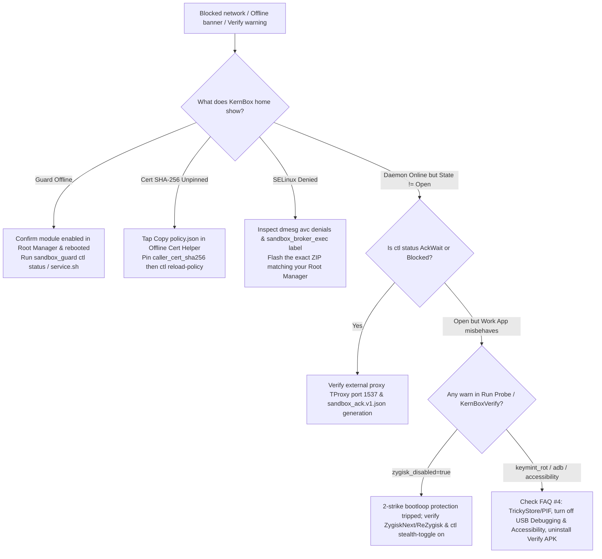

# KernBox Frequently Asked Questions (FAQ)

---

### 1. How does KernBox differ from app cloners or a traditional VPN?

- **App cloners / virtual containers**: Run with user-space hooks inside the same UID/data namespace, making them vulnerable to higher-privilege detection and unable to stop direct clearnet leaks during startup, doze, or proxy switches.
- **Traditional Android `VpnService`**: Exposes `TRANSPORT_VPN` and `tun0` capabilities inside `ConnectivityManager`, which strict risk-scoring apps check directly.
- **KernBox**: Enforces **Fail-Closed Netfilter (`iptables-restore --noflush`)** at the native **Android Work Profile (`user_id = 10`)** boundary over a VPN-free **TProxy** transparent path, paired with **Two-Layer Zygisk PLT + Binder Proxy** stealth, **cgroup hot-freeze**, and **6 switchable region presets**.

---

### 2. How do I provision a Work Profile and bind `KernBox.apk`?

1. If your phone does not have a Work Profile yet (commonly `user_id = 10`), create one using Shelter, Insular, or your DPC manager.
2. Install [`KernBox.apk`](../controller/) in User 0. Before pinning, open `KernBox.apk` and use its **Offline Cert Helper** card to copy its live **SHA-256 signing digest** or ready-to-paste **`policy.json` snippet** (or inspect with `apksigner verify --print-certs KernBox.apk`) into `/data/adb/sandbox_guard/policy.json` (`caller_cert_sha256`; see [`docs/TPROXY_INTEGRATION_EN.md`](TPROXY_INTEGRATION_EN.md)).
3. Once pinned, `KernBox.apk` gives one-tap Start/Pause, `+` User 0 import / split-APK install, long-press Stop / Copy Pkg / Remove, and in-app `RUN_PROBE` diagnostics. You can also toggle pause/resume from your Root Manager's module Action button (`action.sh`), and module removal runs `uninstall.sh` to restore hibernated apps and clean up `SBW_*` netfilter rules.

---

### Troubleshooting Decision Tree

---

### 3. Why is `neutral` the default preset, and when should I apply a regional preset?

- **Safe minimal default**: Fresh installs start in `presets/neutral.json` (`spoof_carrier = false`, `spoof_timezone = false`, `spoof_locale = false`, `spoof_device_region = false`, `spoof_bluetooth = false`) so your device identity is never mismatched against an unconfigured proxy exit.
- **When to switch**: Once your external TProxy exit country is verified, run `ctl preset-apply` once with the matching preset under `presets/` (`jp-docomo`, `us-tmobile`, `uk-ee`, `sg-singtel`, `de-telekom`).
- **Stability rule**: Pin **one long-lived region preset per sandbox**; avoid rapidly flipping countries back and forth, and prefer hot-freeze over repeated data wipes.

---

### 4. How do I handle `warn` items in `KernBoxVerify.apk` (and why uninstall it afterwards)?

1. **`keymint_rot_locked` = `warn`**: The bootloader is unlocked; hardware `RootOfTrust` leaf/chain attestation requires pairing with KernelSU umount + TrickyStore + PlayIntegrityFix.
2. **`accessibility_risk_clean` = `warn`**: Disable non-essential Accessibility Services before running sensitive apps (`appAccessRiskVerdict`).
3. **`usb_debugging_off` = `warn`**: Expected reminder during ADB setup — once verification passes, **disable Developer Options → USB Debugging** and unplug the cable before daily use.
4. **Why uninstall `KernBoxVerify.apk`**: Keeping a self-signed instrumentation APK installed inside the sandbox is an unnecessary fingerprint surface. Run `adb uninstall --user <work_user> com.sandbox.verify` immediately after verification.

---

### 5. What if a boot issue or anomaly occurs after flashing?

- **Automatic Bootloop Kill-Switch**: After 2 consecutive boots that fail to reach `sys.boot_completed = 1`, `post-fs-data.sh` writes `zygisk_disabled` and sets `"enabled": false` in `stealth.json` before Zygote forks.
- **Manual recovery & rollback**: See [`agent-prompts/UPGRADE_AND_ROLLBACK_EN.md`](../agent-prompts/UPGRADE_AND_ROLLBACK_EN.md) and [`agent-prompts/DIAGNOSE_EN.md`](../agent-prompts/DIAGNOSE_EN.md).

---

### 6. Which of the 30 release ZIPs should I flash?

Do not guess manually. Connect ADB and run the read-only prober + deterministic selector:

- Windows: `.\tools\probe_device.ps1 -Out .\dist\device_profile.json`
- macOS / Linux: `sh ./tools/probe_device.sh --out ./dist/device_profile.json`
- Select variant: `python ./tools/select_variant.py --profile ./dist/device_profile.json --json`

See [`VARIANT_MATRIX.md`](../VARIANT_MATRIX.md) for the complete 30-variant build table.
