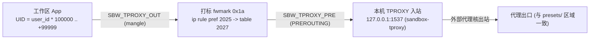

# TProxy 外部代理核对接指南

KernBox 默认开源构建（`!transport_vpn`）采用 **Netfilter TProxy 透明代理路径**：不走 Android `VpnService`，不在工作资料内留下 `TRANSPORT_VPN` / `tun0` 特征，且在启动窗口、锁屏状态与代理升级期间通过 `SBW_RAW_OUTPUT` 实现 **Fail-Closed 阻断防漏流**。

本指南说明外部代理核心（例如 Mihomo / Sing-box 等支持 Linux `TPROXY` 入站的本地核心）如何与 `sandbox_guard` 完成握手。

---

## 1. 数据面路径与内核默认参数



- **默认监听端口**：`1537`（`policy.tproxy_port`，允许范围 `1024..65535`）
- **默认 fwmark**：`0x1a`（`policy.tproxy_mark`，不可为 `0`、`> 0xffff`、`0x14` 或 `0x19`）
- **策略路由表与优先级**：`table 2027`、`pref 2025`
- **默认入站标识**：`sandbox-tproxy`（`policy.proxy_inbound_name`，用于在清理连接时精准关闭工作区入站流）
- **IPv6 约束**：当前版本强制 `ipv6_enabled: false`，`sandbox_guard` 会在 `ip6tables` 侧阻断工作区 IPv6 直连防止泄漏。

---

## 2. 根目录锚定配置 `/data/adb/sandbox_guard/policy.json`

`policy.json` 必须为 **root 属主且仅 `0600` 权限**。先用 `apksigner verify --print-certs KernBox.apk` 读取控制端签名 SHA-256 摘要，再写入配置（以下路径均可按需通过可选项覆盖，绝不写死单一上游目录）：

```json
{
  "user_id": 10,
  "serial": 1,
  "caller_package": "com.sandbox.controller",
  "caller_cert_sha256": "0123456789abcdef0123456789abcdef0123456789abcdef0123456789abcdef",
  "mode": "tproxy",
  "ipv6_enabled": false,
  "tproxy_port": 1537,
  "tproxy_mark": 26,
  "proxy_base_dir": "/data/adb/sandbox_proxy",
  "proxy_ctl_script": "/data/adb/sandbox_proxy/proxy.sh",
  "proxy_config_path": "/data/adb/sandbox_proxy/config.json",
  "proxy_ack_path": "/data/adb/sandbox_proxy/sandbox_ack.v1.json",
  "proxy_core_pid_path": "/data/adb/sandbox_proxy/core.pid",
  "proxy_inbound_name": "sandbox-tproxy",
  "proxy_core_process": "mihomo"
}
```

> **提示**：如工作区尚未导入或需要通过设备测试验证真实网络出口，请先确认主机上的代理配置正常连通（切勿将真实机场订阅或私有 IP 写入任何代码库文件）。

---

## 3. 状态握手契约（`exemption.v1.json` ⇄ `sandbox_ack.v1.json`）

1. **Daemon 写出豁免目标** (`/data/adb/sandbox_guard/exemption.v1.json`)：
   当进入 `StateAckWait` 或打开流量时，守护进程原子写出当前 `generation`、`boot_id`、`user_id`、`uid_start` / `uid_end`、`mode: "tproxy"`、`tproxy_port` 与 `tproxy_mark`。
2. **代理核就绪回执** (`sandbox_ack.v1.json`)：
   代理核启动并开始监听 `tproxy_port` 后，向 `proxy_ack_path`（默认 `/data/adb/sandbox_proxy/sandbox_ack.v1.json`）原子写入当前生效的 `generation` 与 `boot_id`：

```json
{
  "contract_version": 1,
  "applied_generation": 1,
  "boot_id": "00000000-0000-0000-0000-000000000000",
  "core_pid": 4321
}
```

仅当 `sandbox_ack.v1.json` 的 `contract_version == 1`、`boot_id` 与 `/proc/sys/kernel/random/boot_id` 一致且 `applied_generation` 匹配当前代数，同时 TProxy 端口就绪后，`sandbox_guard` 才会切入 `StateOpen` 并解除 `SBW_RAW_OUTPUT` 丢包保护。

---

## 4. 代理核无漏流热升级流程（Upgrade Fence）

日常更新外部代理核二进制或配置时，务必使用升级围栏防止升级瞬间工作区流量直连：

```bash
# 1. 升起升级围栏（默认 TTL 90 秒，上限 300 秒；期间重新闭锁 SBW_RAW_OUTPUT 防漏流）
adb shell su -c "/data/adb/sandbox_guard/sandbox_guard ctl upgrade-begin 90"

# 2. 重启 / 替换外部代理核（例如通过你的 proxy.sh 重启）

# 3. 写入新 generation ack 后解除围栏（或等待新 ack 自动闭合）
adb shell su -c "/data/adb/sandbox_guard/sandbox_guard ctl upgrade-end"
```

---

## 5. 上线自检命令

```bash
# 1. 查看 Daemon 与 TProxy 就绪状态
adb shell su -c "/data/adb/sandbox_guard/sandbox_guard ctl status"

# 2. 检查工作区 mangle 链路与 ip6tables 阻断是否已挂稳
adb shell su -c "iptables -t mangle -S | grep SBW_"
adb shell su -c "ip rule show | grep 2025"
```

接着在工作资料中安装一次 `KernBoxVerify.apk` 跑完 12 项体检并卸载清理（详见 [`agent-prompts/INSTALL_CN.md`](../agent-prompts/INSTALL_CN.md)）。
