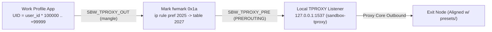

# TProxy External Proxy Core Integration Guide

Default OSS KernBox builds (`!transport_vpn`) route sandbox Work Profile traffic through **Netfilter TProxy**: zero `VpnService`, zero `TRANSPORT_VPN` / `tun0` footprint inside the sandbox, and **Fail-Closed blocking** (`SBW_RAW_OUTPUT`) across boot, lock-screen, and proxy upgrades.

This guide documents the filesystem & Netfilter contract between an external TProxy core (such as Mihomo / Sing-box) and `sandbox_guard`.

---

## 1. Data-Plane Path & Default Kernel Parameters



- **Default TProxy port**: `1537` (`policy.tproxy_port`, valid range `1024..65535`)
- **Default fwmark**: `0x1a` (`policy.tproxy_mark`, non-zero `<= 0xffff`, must not equal `0x14` or `0x19`)
- **Routing table & preference**: `table 2027`, `pref 2025`
- **Default inbound token**: `sandbox-tproxy` (`policy.proxy_inbound_name`, used when flushing only sandbox connections on proxy restarts)
- **IPv6 constraint**: `ipv6_enabled` is forced `false`; `ip6tables` blocks sandbox IPv6 egress to prevent dual-stack leaks.

---

## 2. Root-Pinned Config: `/data/adb/sandbox_guard/policy.json`

`policy.json` must be **root-owned with `0600` permissions**. Obtain your `KernBox.apk` SHA-256 signing digest from the controller's **Offline Cert Helper** (or `apksigner verify --print-certs KernBox.apk`) and write `policy.json` (or generate via `sandbox_guard ctl bootstrap-pin`):

```json
{
  "user_id": 10,
  "serial": 1,
  "caller_package": "com.sandbox.controller",
  "caller_cert_sha256": "0123456789abcdef0123456789abcdef0123456789abcdef0123456789abcdef",
  "mode": "tproxy",
  "ipv6_enabled": false,
  "tproxy_port": 1537,
  "tproxy_mark": 26,
  "proxy_base_dir": "/data/adb/sandbox_proxy",
  "proxy_ctl_script": "/data/adb/sandbox_proxy/proxy.sh",
  "proxy_config_path": "/data/adb/sandbox_proxy/config.json",
  "proxy_ack_path": "/data/adb/sandbox_proxy/sandbox_ack.v1.json",
  "proxy_core_pid_path": "/data/adb/sandbox_proxy/core.pid",
  "proxy_inbound_name": "sandbox-tproxy",
  "proxy_core_process": "mihomo"
}
```

> All `proxy_*` fields are optional overrides so KernBox never hardcodes a single proxy layout. Never commit real subscription URLs or private IPs into any repository file.

---

## 3. Handshake Contract (`exemption.v1.json` ⇄ `sandbox_ack.v1.json`)

1. **Daemon writes exemption target** (`/data/adb/sandbox_guard/exemption.v1.json`):
   Before opening traffic (`StateAckWait` / `StateOpen`), `sandbox_guard` atomically writes the active `generation`, `boot_id`, `user_id`, UID range, `tproxy_port`, and `tproxy_mark`.
2. **Proxy core writes readiness ack** (`sandbox_ack.v1.json`):
   Once the external proxy core is listening on `127.0.0.1:<tproxy_port>` (loopback or wildcard, owned by root/core UID), atomically write `proxy_ack_path` (default `/data/adb/sandbox_proxy/sandbox_ack.v1.json`):

```json
{
  "contract_version": 1,
  "applied_generation": 1,
  "boot_id": "00000000-0000-0000-0000-000000000000",
  "core_pid": 4321
}
```

`sandbox_guard` transitions to `StateOpen` (disarming `SBW_RAW_OUTPUT`) ONLY when `contract_version == 1`, `boot_id` matches `/proc/sys/kernel/random/boot_id`, `applied_generation` matches the current exemption, and the local TProxy listener probe succeeds.

---

## 4. Zero-Leak Hot Upgrade Fence

When upgrading the external proxy core binary or config, raise the upgrade fence first so sandbox traffic never leaks:

```bash
# 1. Raise upgrade fence (default TTL 90s, max 300s; re-arms SBW_RAW_OUTPUT)
adb shell su -c "/data/adb/sandbox_guard/sandbox_guard ctl upgrade-begin 90"

# 2. Restart / replace your external proxy core (e.g. via proxy.sh)

# 3. Clear fence once the new generation ack is in place
adb shell su -c "/data/adb/sandbox_guard/sandbox_guard ctl upgrade-end"
```

---

## 5. Verification Commands

```bash
adb shell su -c "/data/adb/sandbox_guard/sandbox_guard ctl status"
adb shell su -c "iptables -t mangle -S | grep SBW_"
adb shell su -c "ip rule show | grep 2025"
```

Finish by running `KernBoxVerify.apk` once inside the Work Profile and uninstalling it immediately afterwards (see [`agent-prompts/INSTALL_EN.md`](../agent-prompts/INSTALL_EN.md)).
